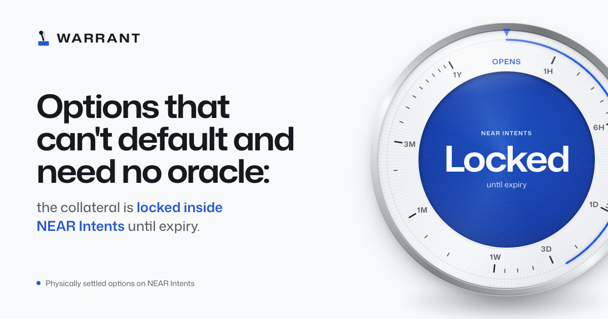

<div align="center">



[](https://github.com/emmanuelist/warrant/actions/workflows/ci.yml)
[](LICENSE)
[](#tests)
[](https://nearblocks.io/address/warrant-options.near)
[](https://nearblocks.io/address/warrant-options.near/contract/code)

**Options that can't default and need no oracle: the collateral is locked inside NEAR Intents until expiry.**

**[Live app](https://warrant-options.vercel.app)** · **[The contract](https://nearblocks.io/address/warrant-options.near/contract/code)** · **[Check it yourself](#try-it)** · **[Proof](#proof-nothing-here-is-a-mockup)** · **[Limits](#limits)**

Built for NEAR HACKATHON, tracks `defi` and `open`.

</div>

## What it is

An options market on NEAR mainnet. A writer locks collateral inside `intents.near` and receives options, each one a NEP-245 token. A holder can exercise until expiry: they pay the strike inside Intents and receive the underlying inside Intents. After expiry the writer takes back what wasn't exercised. Nothing can move that collateral in between, and no price feed is consulted, because the holder decides whether exercising is worth it.

A wallet on another chain can take part with no NEAR account. It pays in through 1Click, signs intents, and a relayer that can only call `execute_intents` pays the gas.

## The problem it solves

An option is a promise, and on-chain promises usually lean on one of two outside parties. Under-collateralized options need a margin engine and liquidators to keep the seller solvent. Cash-settled options need an oracle at expiry. On NEAR that risk is concrete: Pyth's feed had stopped updating when this was built ([E-001](docs/EVIDENCE.md)).

Warrant needs neither. Every option is fully collateralized when written and settles by delivering the asset.

## Try it

Each step says what to do and what you should see. The first three need no install, no wallet and no funds.

**1. Open the app.** Go to <https://warrant-options.vercel.app>.
You see a dial reading the collateral locked inside Intents, and a board of series. Every figure is read from mainnet in your browser. There's no backend for reads and no database.

**2. Watch the contract refuse.** Scroll to "Every way in, refused".
The page fetches 31 real transactions by hash from an archive node. You see "28 of 28 refused by name" and "3 of 3 honest calls went through". Each row links to its transaction on NearBlocks.

**3. Check every claim from a terminal.** You need only Node 22 or newer. It reads mainnet and Base, and sends nothing.

```bash
git clone https://github.com/emmanuelist/warrant && cd warrant
node scripts/verify.mjs
```

You see `PASS` lines for the deployed code, the source link, an outside rebuild, the contract's empty key list, the backing inside Intents, the refusal room, the wallet-signed purchase, the relayer's key, the round trip on both chains, and the hosted page and relayer, then `Every claim above holds on chain.` It takes under a minute.

Without a terminal, [the contract on NearBlocks](https://nearblocks.io/address/warrant-options.near/contract/code) says "Contract Source Code Verified", from a rebuild SourceScan ran on its own, and lists the source files. Its Overview tab says "Contract Locked: Yes".

**4. Send a refusal yourself.** You need a NEAR wallet with about 0.1 NEAR free. On the board, open a series and pull a lever marked locked, or choose "Send one yourself" under Refusals.
Your wallet shows the call. You see "Refused by chain" and the contract's own error, such as `ERR_NOT_WRITER`, with your transaction hash. It costs a fraction of a cent in gas, and nothing else moves.

**5. Rebuild the deployed contract.** You need Docker, `rustup` and [cargo-near](https://github.com/near/cargo-near) 0.22.0.

```bash
git checkout mainnet-v0.1.0
cd contracts/options
cargo near build reproducible-wasm
```

It takes about five minutes. You see `SHA-256 checksum bs58: DADQfyxqwetsaZBh5n7JEQ8MnwZKQiqzCxaS465svgYz`, which is the `code_hash` of [`warrant-options.near`](https://nearblocks.io/address/warrant-options.near). If it stops early with an SSL error while fetching `near/intents`, that's the network inside the container, and running it again works.

**6. Run the tests.** You need `rustup`, which picks up rustc 1.97.1 from `rust-toolchain.toml`, and cargo-near.

```bash
cd contracts/options
cargo near build non-reproducible-wasm --abi-features abi
cargo test -- --test-threads=1
```

You see 78 unit tests pass, then the `sandbox` suite (3) and the `signers` suite (1). See [Tests](#tests).

**7. Run the whole app on a local chain.** This also shows flows you'd otherwise need funds for.

```bash
# In contracts/options. Leave it running until you see DEVNET READY.
cargo test --test devnet -- --ignored --nocapture

# In a second terminal
cd web && npm ci && npm run dev
```

Open `http://localhost:5173/?as=alice.sandbox`. You see the same board on a devnet that runs byte-identical Intents, and the page signs as any seeded account: `/account?as=bob.sandbox` shows a holder's positions. `node scripts/run.mjs --devnet write && node scripts/run.mjs --devnet room` sends the whole refusal room there and stops unless each attempt ends as it must.

## Proof: nothing here is a mockup

No demo mode, no seeded database, no fixtures. Every figure in the app is a contract view, an Intents balance, or a 1Click answer. All of it is on mainnet at demo sizes, under $2 a trade. The full record, with commands and output, is in [docs/EVIDENCE.md](docs/EVIDENCE.md).

| Claim | Check it | Evidence |
|---|---|---|
| The contract is live and its code is this repo's | [`warrant-options.near`](https://nearblocks.io/address/warrant-options.near), `code_hash DADQfyxq…svgYz`, built reproducibly at tag `mainnet-v0.1.0`; the source link is on chain (NEP-330) | E-031 |
| Someone else rebuilt it and got the same hash | SourceScan built this repo at the commit named on chain. [NearBlocks shows "Contract Source Code Verified"](https://nearblocks.io/address/warrant-options.near/contract/code), and the record is on chain: `get_contract` on `v2-verifier.sourcescan.near` (`verify.mjs` reads it) | E-037 |
| Nobody holds the contract's keys, so nobody can deploy new code | `near account list-keys warrant-options.near network-config mainnet now` prints an empty table. [The last key's deletion](https://nearblocks.io/txns/A1mX5E2cJSUkjWMhiQoZ1bn5fJCekprQBHJgBb11qi5j) | E-035 |
| Collateral sits inside Intents, under the contract's own account | `mt_balance_of` on `intents.near` for `warrant-options.near`, compared with what every series owes (`verify.mjs`, or the "Backed 1:1" line in the app) | E-031 |
| Every refusal the contract names fires on mainnet | 28 real attempts reach all 26 named refusals, refused attempts move no money, and 3 honest calls go through. Hashes are in [`web/.env.production`](web/.env.production), e.g. the writer reclaiming early: [`8vPwm6Qr…`](https://nearblocks.io/txns/8vPwm6QrKDHkM2EtSYA5gT64qzuB4nTayz5zePbGt5Xt) `ERR_NOT_EXPIRED` | E-031 |
| A full cycle ran: write, buy, exercise, expire, reclaim | [Write](https://nearblocks.io/txns/2L53cjfgp4yB2Ptf4FqDHxqbT4ZKJTY4G1RgUkPrdE4F) · [buy](https://nearblocks.io/txns/Fy1eGLFp1a3zXnmzEZLb2mMH1hrPCVtep2F5TbDZsXZ2) · [exercise](https://nearblocks.io/txns/AGhabFx252CkRkNF4z5di7k3pWsLDmHTTQ2ZxG4SPurD) · [reclaim after expiry](https://nearblocks.io/txns/61BMogv9VnjWZYhs4Bsn4yJV8Dbyh3ViYSYkUtuA1yBJ) · [reclaim refused the second time](https://nearblocks.io/txns/FwHdsPWaFsyL3tUvquzrvTU2H4BVV1LrRvygCd2xAWxW) | E-031 |
| A real wallet signs from the hosted page | Intear Wallet through near-connect, approving a purchase: [`CvMRoftt…`](https://nearblocks.io/txns/CvMRoftt8jhibE7pchQvZ3JBb9bXnDXUNAkwzonseGPU) | E-031 |
| A position moves between accounts as an Intents asset | [Into Intents](https://nearblocks.io/txns/2nk3oMrDNLYcdQ2WAfRtN6YCeYQV4G3SCYnJ287evCxD) · [to a `0x` account inside Intents](https://nearblocks.io/txns/2zXKYV6nrKdtjVhg2zid8oEzXcNZRuyqym1QaEZzP1eP) · [back to Warrant's ledger through the relayer](https://nearblocks.io/txns/GZ58bApzGnChGTD1hP7d8mmzsct2PZwAZjPEt89MnWVB) | E-033 |
| A wallet with no NEAR account goes all the way round | One `0x05db…7b0b`, through the hosted page: [USDC in on Base](https://basescan.org/tx/0xbd6289cc629a617fd25d6f0ecadde052a58421a3eb2d67d8704deb31bb340b1e) · [buys](https://nearblocks.io/txns/AMbpVMg6XbMZxywmMDEJJiffdD32rQXSnSPZBXGKTGQA) · [exercises](https://nearblocks.io/txns/EyQj34zmL54Cm3fCLW8AB6Qf9DFxRMNuRvSdVNRSoNw1) · [writes a put](https://nearblocks.io/txns/83iL1EDED9azK8GCgc8EJgqSPjGu994efF4u6SoPZPNH) · [paid in USDC on Base](https://basescan.org/tx/0xa3a88f87aa6663d4539a1a7151e93c9ddb441e79279d5096434298d34529f172) | E-032 |

The first real runs found things no local test could, and each is written down: gas charged up front, a free node's rate limit, a chart path that needed a live price, a relayer allowance that would have run out (E-031, E-032, [D-041](docs/DECISIONS.md), [D-042](docs/DECISIONS.md)).

## How it works

| Part | Where | What it does |
|---|---|---|
| Options contract | [contracts/options](contracts/options) | Holds each series, offer and position. Collateral arrives through `intents.near` `mt_transfer_call`, and every payout is `mt_transfer` inside Intents. Behaviour and every refusal: [docs/SPEC.md](docs/SPEC.md) |
| Web app | [web/src](web/src) | One board and an account page. Shows exactly what you'll sign, then reads the result back from chain |
| Relayer | [web/relay](web/relay) | Pays gas for wallets with no NEAR account. Refuses anything but a Warrant action, previews with `simulate_intents`, then sends `execute_intents` with a key that can do nothing else |

The lifecycle of one call option, 0.1 wNEAR at a strike of 0.45 USDC:

1. **Write.** The writer sends 0.1 wNEAR to the contract through `intents.near` and gets one long. The wNEAR now sits in the contract's Intents balance.
2. **Sell.** The writer lists the long. A buyer pays the premium inside Intents and gets it.
3. **Exercise, before expiry.** The holder pays 0.45 USDC through Intents and receives 0.1 wNEAR inside Intents. If they don't hold the long, or pay too little, or are late, the contract refuses and Intents refunds them in full.
4. **Reclaim, after expiry.** The writer takes back what wasn't exercised, and collects the strike whenever they like. Before expiry, the same call is refused.

What makes the lock hold:

- The contract credits only what `intents.near` itself reports, and every payout is scheduled and accounted for ([SPEC](docs/SPEC.md)).
- There's no owner path to the money. The owner can only edit the token allowlist.
- The contract's account has no keys, so its code can't be replaced ([E-035](docs/EVIDENCE.md)).
- About 32,000 random steps check the books against the transfers actually scheduled, and 12 of 12 injected bugs are caught ([E-028](docs/EVIDENCE.md), [E-029](docs/EVIDENCE.md)).

### NEAR's role

This can't be moved to another chain by swapping an oracle. It leans on what NEAR Intents is:

- **Collateral is an Intents balance.** It sits in the same ledger people trade on, so a payout is an `mt_transfer` on that ledger rather than a bridge or a separate vault token.
- **A position is an Intents asset.** A long moves in and out of `intents.near` as `nep245:warrant-options.near:<series>` and transfers between accounts like any other token there.
- **Any chain can take part.** 1Click routes USDC from Base into a `0x` account's Intents balance and back out, and that account signs ERC-191 intents with the wallet it already has.
- **Refunds come from the standard.** When the contract refuses a payment, `mt_on_transfer` returns the amount and Intents gives it back. A refused exercise leaves the holder whole with no code path of ours moving the money back.

NEAR technology used: NEAR Intents (`mt_transfer_call`, `mt_transfer`, `execute_intents`, `simulate_intents`, the `transfer`, `auth_call` and `mt_withdraw` intents), the 1Click API, NEP-141, NEP-245, NEP-330, NEP-413, ERC-191 signing on Intents, and near-connect with EIP-6963 for wallets.

## Tests

```text
78 unit · sandbox 3 · signers 1          cargo test -- --test-threads=1
```

- **Failure paths:** early reclaim, late exercise, exercise without the option, unauthorized calls, wrong-token deposits, double exercise, and each of the 26 named refusals.
- **Invariants:** one of the 78 runs about 32,000 random steps across every action, checks the books after each against the transfers the contract actually schedules, winds every sequence down until nothing is left, and fails if any action or refusal was never reached. `cargo test invariants -- --nocapture` prints the counts.
- **Real bytecode:** the `sandbox` suites download the live `intents.near` and `wrap.near` from mainnet and refuse to run if their hash differs from the pin in `tests/common/mod.rs`.
- **Signers:** the `signers` suite has a wallet with no NEAR account write, list, cancel, claim and reclaim through relayed `erc191` intents.
- **Web:** `npm run lint` and `npm run build`, plus `web/scripts/relay-check.mjs` against a devnet.

## Limits

- **Not audited, demo sizes.** The series on mainnet are small and were written by accounts I control, disclosed in [E-031](docs/EVIDENCE.md) and [E-032](docs/EVIDENCE.md). What isn't proven yet is listed in [docs/STATE.md](docs/STATE.md).
- **No keys, so no patches.** The contract's account has no access keys, which is what makes the lock checkable. It also means a bug can't be fixed: the code stays as it is ([D-035](docs/DECISIONS.md), [E-035](docs/EVIDENCE.md)).
- **Smallest series.** Writing a series takes about $20 of collateral: 5 wNEAR or 20 USDC. That was raised after the film and the small series on the board were written, so a write the size of the film's is now refused with `ERR_BELOW_MIN`. Buying, exercising and reclaiming have no minimum ([D-045](docs/DECISIONS.md)).
- **Retiring.** From 2026-11-26, once the contract holds nothing for anyone, anyone can retire it: its account is deleted and its storage deposit returns to its owner. It moves no tokens, and it refuses while it holds a single unit. A writer who never reclaims keeps it from retiring, and so would longs spread across about 60 to 100 more accounts, because the chain won't delete an account holding over 10 KB of state. Nobody's tokens are at risk either way, only that deposit ([D-038](docs/DECISIONS.md), [D-045](docs/DECISIONS.md), [SPEC](docs/SPEC.md)).
- **It hasn't retired yet.** `retire` has only run on the real runtime in the sandbox, because it can't run on mainnet before 2026-11-26 ([E-029](docs/EVIDENCE.md)).
- **Storage.** The contract pays for its own storage from a finite balance. Filling it would refuse transactions that add state until someone tops it up.
- **Wallets.** Only Intear is exercised among NEAR wallets ([D-040](docs/DECISIONS.md)). The EVM round trip was signed by a local key in the browser, not an extension, so a real extension's prompt is unproven. Wallets with no NEAR account means EVM only; Solana and passkey signers aren't built ([D-030](docs/DECISIONS.md)).
- **Relayer.** Its gas allowance is finite, about 40 more actions. When it runs out, EVM wallets are told so and NEAR wallets aren't affected ([D-042](docs/DECISIONS.md)).
- **Reads.** The page reads through free public nodes and fails over between them. Under heavy use from one address, reads can slow down.
- **Market.** No sorting or search, and offers are fixed-price with no order book. There's no market maker ([D-043](docs/DECISIONS.md)). The offers on the board are two small series I wrote and listed at 0.01 USDC, so a visitor has something to buy.
- **Physical settlement.** A holder must bring the strike to exercise. There's no cash settlement by design ([D-002](docs/DECISIONS.md)).
- **1Click's fee.** It's used without a partner key, so its quotes include the extra fee for that ([D-018](docs/DECISIONS.md)).

## When and how it was built

Built from 2026-10-20, inside the window the organizers set from the announcement on 2026-10-19 (their Q-001). Git history starts on 2026-11-05, so the dated record is [docs/DECISIONS.md](docs/DECISIONS.md) and [docs/EVIDENCE.md](docs/EVIDENCE.md). There's no pre-hackathon code.

Written with Claude Code (AI), under the rules in [CLAUDE.md](CLAUDE.md). Current state: [docs/STATE.md](docs/STATE.md).

Libraries and templates:

- **Contract:** near-sdk 5.29.1, `defuse-nep245` from `near/intents` at the deployed commit, and the `cargo near new` template with its near-sandbox and near-api test stack
- **Web:** React, Vite, Tailwind, TypeScript, motion, @number-flow/react, @radix-ui/react-tooltip, @phosphor-icons/react, @hot-labs/near-connect
- **Dev only, never bundled:** @noble/curves and @noble/hashes

Exact versions are in `contracts/options/Cargo.lock` and `web/package-lock.json`.

## License

[MIT](LICENSE).
